# Tanque Cheio — controle de gastos com combustível

Aplicativo Flutter para registrar os abastecimentos de um veículo e acompanhar os gastos com combustível e o consumo ao longo do tempo.

> Atividade Substitutiva da Prova 1 — Programação para Dispositivos Móveis I (Fatec, Prof. Arley).

<p align="center">
  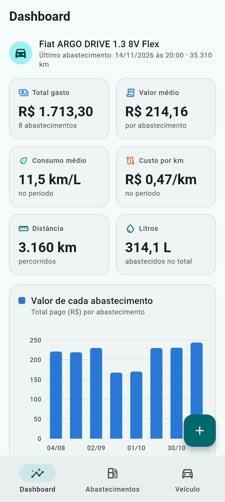
  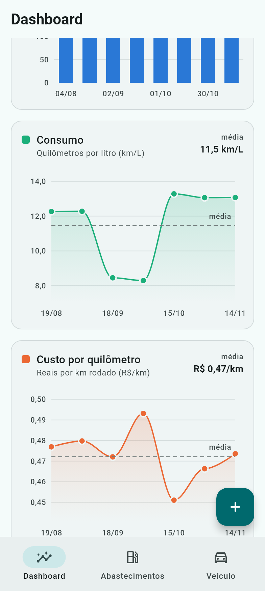
  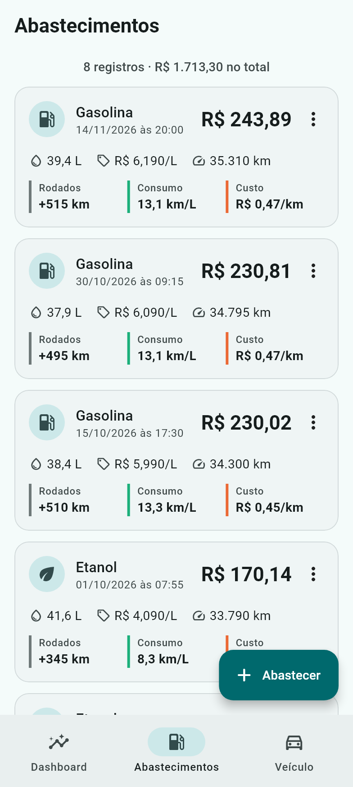
</p>

## Sumário

- [Funcionalidades](#funcionalidades)
- [Como os indicadores são calculados](#como-os-indicadores-são-calculados)
- [Como executar](#como-executar)
- [API utilizada](#api-utilizada)
- [Bibliotecas adotadas](#bibliotecas-adotadas)
- [Arquitetura](#arquitetura)
- [Testes](#testes)
- [Capturas de tela](#capturas-de-tela)

## Funcionalidades

| Requisito | Como o app atende |
|---|---|
| **Cadastro do veículo** (marca, modelo, ano, cilindrada) | Tela de cadastro com tipo de veículo (carro, moto ou caminhão), marca e modelo consultados na tabela FIPE da BrasilAPI. A lista de modelos depende da marca escolhida. A cilindrada é sugerida a partir do nome do modelo (ex.: "ARGO DRIVE **1.3** 8V" → 1300 cm³) e pode ser corrigida. |
| **Apenas um veículo por vez** | O banco recusa um segundo cadastro. Para trocar de veículo, a aba *Veículo* oferece a exclusão, com diálogo de confirmação que informa quantos abastecimentos serão apagados junto. A exclusão remove o veículo e os abastecimentos dele numa única transação. |
| **Registro de abastecimentos** | Combustível (etanol, gasolina ou diesel), preço por litro (com 3 casas, como nas bombas), quilometragem, litros, data e horário. O **valor total** (preço × litros) aparece enquanto o usuário digita. Os registros também podem ser editados e excluídos. |
| **Persistência local** | SQLite no próprio aparelho (`sqflite`). Os dados continuam lá depois que o app é fechado e aberto de novo, inclusive na versão web (SQLite em WebAssembly salvo no navegador). |
| **Dashboard e gráficos** | Indicadores-resumo (total gasto, valor médio, consumo médio, custo médio por km, distância e litros), gráfico de barras com o **valor de cada abastecimento**, gráficos de linha com a evolução do **consumo (km/L)** e do **custo por km (R$/km)**, e uma tabela com os números de cada abastecimento. |
| **Navegação** | Três abas (Dashboard, Abastecimentos e Veículo) com `go_router`. Sem veículo cadastrado, o app leva sozinho à tela de cadastro; ao excluir o veículo, volta para ela. |

Também foram cuidados:

- **Validações**: o hodômetro só aumenta. Por isso, a quilometragem precisa ser maior que a do abastecimento anterior e menor que a do seguinte (vale também para registros retroativos), e a mensagem diz qual registro está em conflito. Ano, cilindrada, preço e litros também são validados, e não se aceita data no futuro.
- **Responsividade**: no celular, barra de navegação inferior; em tablets e telas largas, navegação lateral (`NavigationRail`), indicadores em 3 ou 6 colunas e gráficos lado a lado. Formulários têm largura máxima, para não esticar.
- **Modo claro e escuro**, seguindo o sistema, com cores dos gráficos ajustadas para cada modo.
- **Erros tratados**: falta de internet ou falha da API mostram mensagem clara com botão *Tentar novamente*; falhas do banco viram mensagens amigáveis.
- **Busca tolerante** nas listas de marca e modelo (a Fiat tem centenas de modelos): ignora acentos, maiúsculas e a ordem das palavras ("citroen" encontra "Citroën"; "argo 1.3" encontra "ARGO DRIVE 1.3 8V Flex").
- **Formato brasileiro** em valores, datas e números (R$ 1.234,56 · 12,5 km/L · 20/11/2026).

## Como os indicadores são calculados

Como pede o enunciado, todo abastecimento completa o tanque. A partir do segundo registro, em ordem cronológica:

| Indicador | Fórmula |
|---|---|
| Valor do abastecimento | preço por litro × litros (arredondado para centavos) |
| Distância percorrida | km atual − km do abastecimento anterior |
| Consumo (km/L) | distância ÷ litros do abastecimento atual |
| Custo (R$/km) | valor do abastecimento atual ÷ distância |

O **primeiro abastecimento** é a referência inicial e aparece sem km/L e sem R$/km.

As **médias do período** são ponderadas: consumo médio = distância total ÷ litros consumidos nela; custo médio = valor gasto ÷ distância total. Assim, um trecho de 500 km pesa mais que um de 100 km, o que não acontece numa média simples. Os litros do primeiro abastecimento ficam fora, porque foram consumidos antes do período medido.

A regra está isolada em [`lib/domain/models/refueling_insight.dart`](lib/domain/models/refueling_insight.dart) e [`consumption_report.dart`](lib/domain/models/consumption_report.dart), com testes unitários.

## Como executar

### Pré-requisitos

- [Flutter](https://docs.flutter.dev/get-started/install) **3.47 ou superior** (desenvolvido com Flutter 3.47.3 / Dart 3.13.3);
- um emulador Android, um iPhone/simulador, ou o Google Chrome;
- internet no primeiro cadastro (para consultar marcas e modelos).

### Passos

```bash
git clone https://github.com/Carlos-Santo/Atividade-Substitutiva.git
cd Atividade-Substitutiva
flutter pub get

# Ver os aparelhos disponíveis
flutter devices

# Rodar no emulador/celular Android ou iOS
flutter run

# Ou rodar no navegador
flutter run -d chrome
```

### APK para instalar no celular

A cada push, o GitHub Actions ([`.github/workflows/build-apk.yml`](.github/workflows/build-apk.yml)) roda a análise e os testes e gera o APK, sem precisar de Android SDK na máquina:

1. No GitHub, abra a aba **Actions** e entre na execução mais recente do workflow **Testes e APK**;
2. Em **Artifacts**, baixe **tanque-cheio-apk** (vem num `.zip` com o `app-release.apk` dentro);
3. Passe o APK para o celular e abra o arquivo. O Android pede para permitir a instalação de "fontes desconhecidas" para o app usado para abrir o arquivo.

Com o Android SDK instalado, também dá para gerar localmente: `flutter build apk --release` (o arquivo fica em `build/app/outputs/flutter-apk/app-release.apk`).

> **Web:** os arquivos `web/sqlite3.wasm` e `web/sqflite_sw.js` já estão no repositório. Se atualizar o pacote `sqflite_common_ffi_web`, gere-os de novo com `dart run sqflite_common_ffi_web:setup`.

## API utilizada

**[BrasilAPI](https://brasilapi.com.br/docs#tag/FIPE)**, módulo FIPE: é pública, gratuita e não exige chave.

| Uso | Endpoint |
|---|---|
| Marcas por tipo de veículo | `GET https://brasilapi.com.br/api/fipe/marcas/v1/{carros\|motos\|caminhoes}` |
| Modelos da marca escolhida | `GET https://brasilapi.com.br/api/fipe/veiculos/v1/{tipo}/{codigoMarca}` |

As respostas ficam em memória durante a sessão, então trocar de marca e voltar não repete a requisição. Se uma resposta antiga chegar depois de o usuário já ter trocado de marca, ela é descartada.

## Bibliotecas adotadas

| Pacote | Para quê |
|---|---|
| [`http`](https://pub.dev/packages/http) | Requisições à BrasilAPI. |
| [`sqflite`](https://pub.dev/packages/sqflite) | Banco SQLite local no Android e iOS. |
| [`sqflite_common_ffi`](https://pub.dev/packages/sqflite_common_ffi) / [`sqflite_common_ffi_web`](https://pub.dev/packages/sqflite_common_ffi_web) | Mesmo banco no desktop e no navegador (e nos testes). |
| [`path`](https://pub.dev/packages/path) / [`path_provider`](https://pub.dev/packages/path_provider) | Caminho do arquivo do banco. |
| [`fl_chart`](https://pub.dev/packages/fl_chart) | Gráficos de barras e de linha do dashboard. |
| [`go_router`](https://pub.dev/packages/go_router) | Navegação declarativa, abas com estado preservado e redirecionamentos. |
| [`provider`](https://pub.dev/packages/provider) | Injeção de dependências e estado das telas (`ChangeNotifier`). |
| [`intl`](https://pub.dev/packages/intl) + `flutter_localizations` | Formatação pt-BR e calendário/relógio em português. |
| [`flutter_lints`](https://pub.dev/packages/flutter_lints) | Análise estática (com regras extras em `analysis_options.yaml`). |

## Arquitetura

O projeto segue o [guia oficial de arquitetura do Flutter](https://docs.flutter.dev/app-architecture): MVVM com uma camada de dados (serviços + repositórios) e uma camada de interface (telas + ViewModels). As regras de negócio ficam num domínio que não depende do Flutter Material nem do banco.

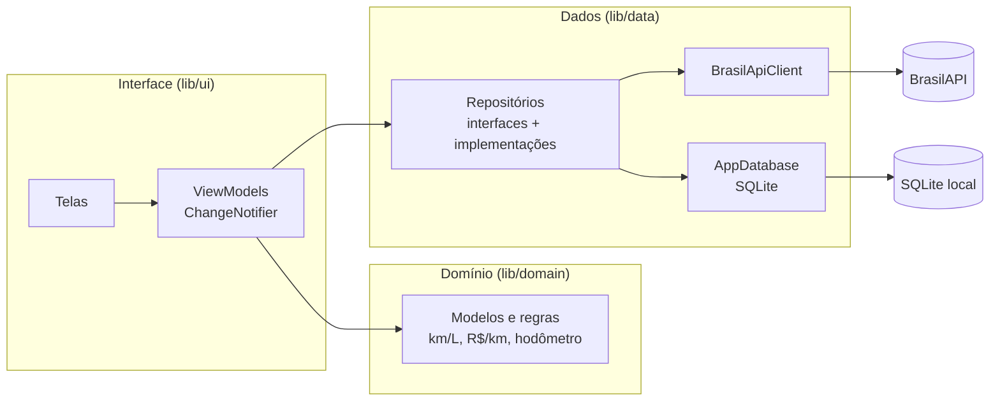

```
lib/
├── main.dart                 # monta as dependências e inicia o app
├── app.dart                  # MaterialApp, tema, localização e injeção
├── core/                     # código comum sem regra de negócio
│   ├── errors/               # AppException (mensagens prontas para o usuário)
│   ├── formatting/           # formatação pt-BR, entrada numérica, busca
│   └── validation/           # validadores dos formulários
├── domain/models/            # Vehicle, Refueling, indicadores e regras
├── data/
│   ├── services/             # BrasilApiClient e AppDatabase (SQLite)
│   └── repositories/         # contratos + implementações (API e SQLite)
└── ui/
    ├── core/                 # tema, cores dos gráficos, breakpoints, widgets comuns
    ├── routing/              # rotas e redirecionamentos (go_router)
    ├── garage/               # GarageViewModel: estado compartilhado do app
    ├── shell/                # navegação adaptativa (barra inferior / lateral)
    ├── dashboard/            # indicadores, gráficos e tabela
    ├── refueling/            # lista e formulário de abastecimentos
    ├── vehicle/              # cadastro (com busca FIPE) e detalhes do veículo
    └── splash/               # carregamento inicial e erro
```

Principais decisões:

- **Repositórios como interfaces.** As telas não sabem se os dados vêm do SQLite, da API ou de uma versão em memória. Trocar o armazenamento (por exemplo, por sincronização em nuvem) ou suportar vários veículos exige mudar só a camada de dados.
- **Fonte única de verdade.** O `GarageViewModel` guarda o veículo, o histórico e o relatório calculado, e todas as abas leem dele. Depois de qualquer alteração, os indicadores são recalculados e as telas são atualizadas.
- **Navegação guiada pelo estado.** O roteador escuta só o estado de navegação (carregando, com ou sem veículo) e redireciona sozinho. As telas não precisam decidir para onde ir depois de cadastrar ou excluir.
- **Erros tipados.** As falhas técnicas (HTTP, timeout, SQLite) viram `AppException` com mensagem em português, e a interface só exibe a mensagem.
- **Banco versionado.** O esquema tem versão e um ponto de migração (`onUpgrade`), com chave estrangeira `ON DELETE CASCADE` e restrições `CHECK` como proteção extra.
- **Formatos e cores centralizados** (`Formatters`, `AppTheme`, `ChartPalette`), para manter o visual consistente entre as telas.

## Testes

```bash
flutter analyze   # análise estática: sem avisos
flutter test      # 73 testes
```

| Camada | O que é testado |
|---|---|
| Domínio | Fórmulas de km/L e R$/km, referência inicial, médias ponderadas, ordem cronológica, faixa válida do hodômetro, sugestão de cilindrada. |
| Núcleo | Formatação pt-BR, leitura de números com vírgula, busca sem acentos, validadores. |
| Dados | Cliente da BrasilAPI (sucesso, erro HTTP, JSON inválido, sem rede, timeout), cache do catálogo e SQLite real em memória (cadastro único, exclusão em cascata, gravação e edição). |
| Interface | ViewModels (inclusive respostas da API fora de ordem) e fluxos completos com navegação: cadastro, validações, registro de abastecimento, exclusão, erro de rede e layout em tablet. |

Também há um teste de integração com a BrasilAPI real, desligado por padrão porque depende de internet:

```bash
flutter test --run-skipped --tags live
```

As capturas abaixo são geradas pelo próprio app, com dados de exemplo:

```bash
flutter test --update-goldens --tags screenshots tool/screenshots
```

## Capturas de tela

| Cadastro do veículo | Busca de modelo (FIPE) | Dashboard |
|:---:|:---:|:---:|
| 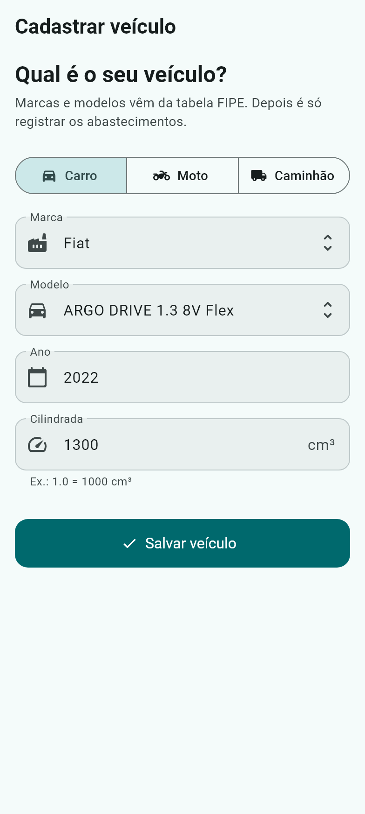 | 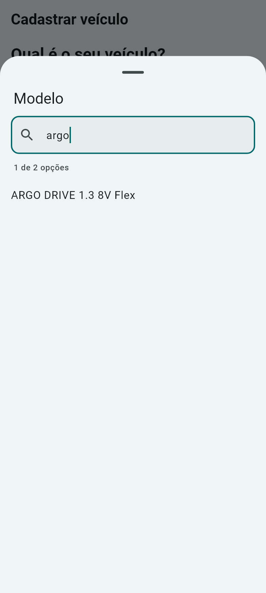 |  |

| Consumo e custo por km | Indicadores por abastecimento | Lista de abastecimentos |
|:---:|:---:|:---:|
|  | 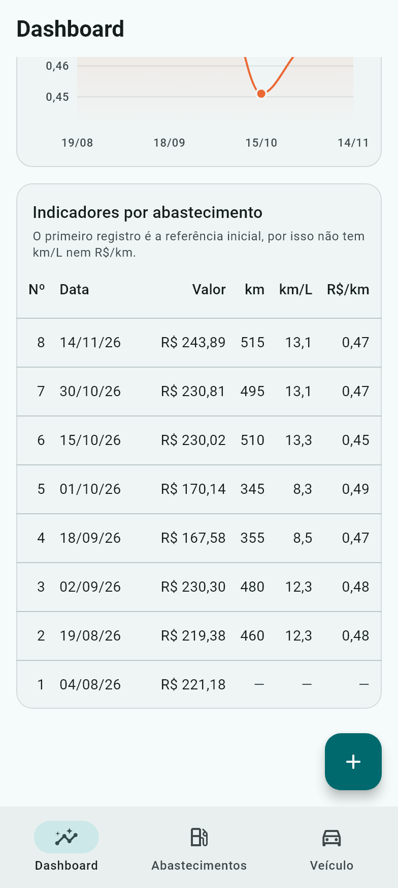 |  |

| Novo abastecimento | Veículo cadastrado | Exclusão com confirmação |
|:---:|:---:|:---:|
| 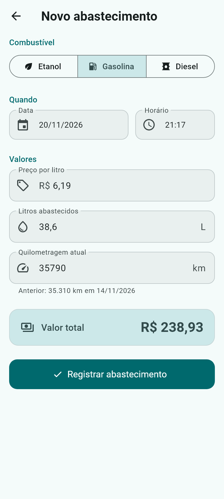 | 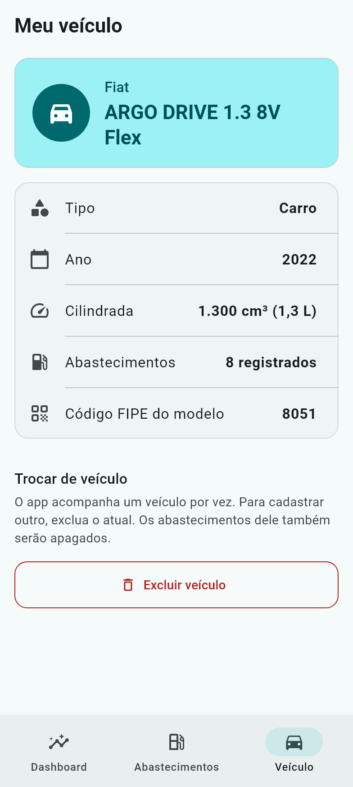 | 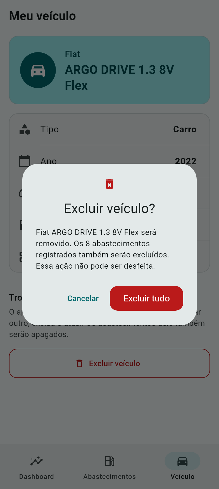 |

### Rodando no Android

Capturas do APK instalado num celular Android, com dados digitados na hora:

| Lista de abastecimentos | Novo abastecimento | Indicadores | Exclusão do veículo |
|:---:|:---:|:---:|:---:|
| 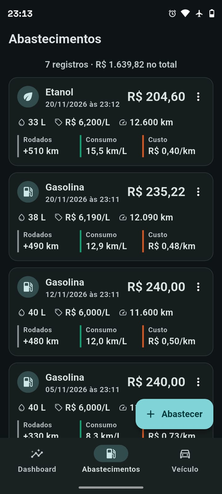 | 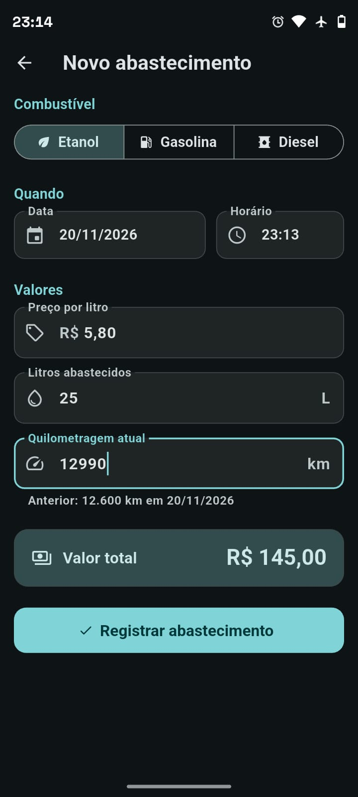 | 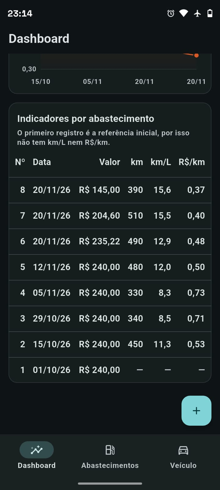 | 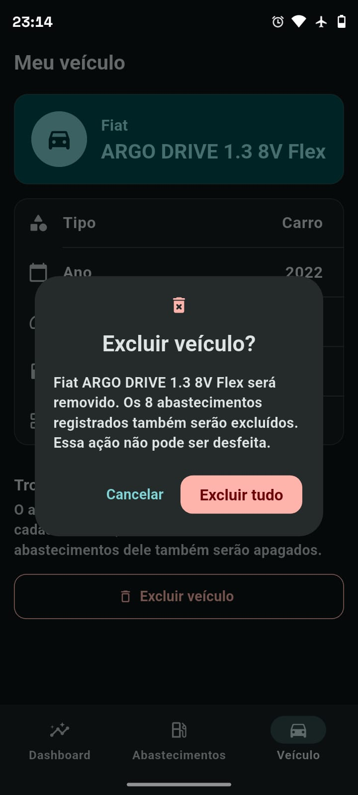 |

**Tablet, modo escuro**: navegação lateral, indicadores em uma linha e gráficos lado a lado.

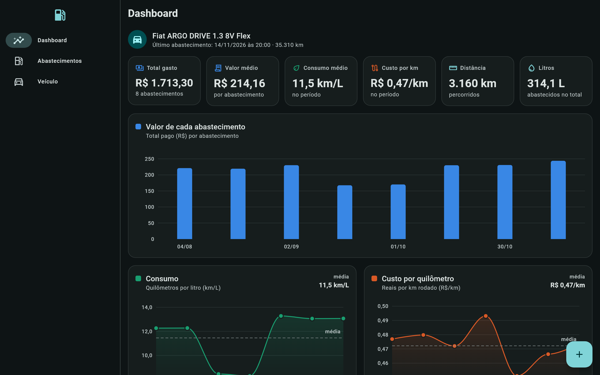
